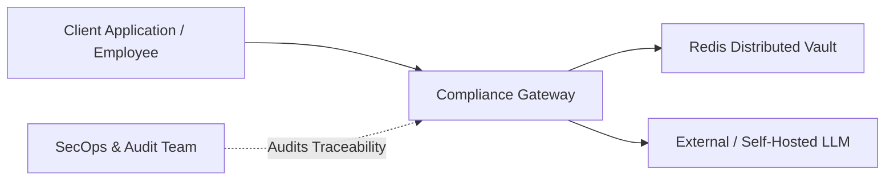

# User Requirements Document (URD)
## Zero-Trust GenAI Compliance Gateway

**Document Reference**: URD-GW-2026-V1  
**Classification**: Enterprise Architecture & Security Standard  
**Compliance Standard Alignment**: GDPR (EU 2016/679), HIPAA (45 CFR § 164.514), NIST AI RMF 1.0, SOC 2 Type II  
**Status**: APPROVED / IN PRODUCTION  

---

## 1. Executive Summary & Purpose

The **Zero-Trust GenAI Compliance Gateway** is an intermediary proxy service positioned between internal enterprise applications and third-party Large Language Model (LLM) providers (e.g., Anthropic, OpenAI, Google Gemini, self-hosted vLLM clusters). 

In an enterprise operating under strict regulatory boundaries, sending raw prompt inputs to external AI systems introduces catastrophic regulatory, security, and financial exposures:
- **PII / PHI Exfiltration**: Accidental disclosure of Personally Identifiable Information (PII) or Protected Health Information (PHI) violates GDPR, HIPAA, and data localization laws.
- **Prompt Injection & Token Forging**: Attackers may inject obfuscated homoglyphs, zero-width characters, or pre-existing compliance tokens to hijack gateway detokenization.
- **Rogue Spend & Denial-of-Wallet**: Uncontrolled prompt token volume can quickly exhaust cloud AI budgets or saturate downstream rate limits.

The gateway addresses these exposures by enforcing a **strict Zero-Trust posture**: every payload is validated against tamper-proof data contracts, sanitized against evasion vectors, pseudonymized into ephemeral session-scoped tokens, bounded by distributed quota budgets, and guaranteed to **fail closed** if any engine or storage dependency fails.

---

## 2. Regulatory & Compliance Framework Alignment

| Regulatory Framework | Mandate / Article | Gateway Architectural Control & Enforcement |
| :--- | :--- | :--- |
| **GDPR (EU 2016/679)** | **Article 25** (*Data Protection by Design & Default*) | All PII (emails, SSNs) is automatically stripped and replaced with ephemeral tokens `<EMAIL_TOKEN_n>`, `<SSN_TOKEN_n>` before exiting the enterprise trust boundary. |
| **GDPR (EU 2016/679)** | **Article 32** (*Security of Processing & Pseudonymization*) | Pseudonymization mappings are stored in memory or encrypted Redis with strict per-session TTLs (3,600s), ensuring keys automatically expire and comply with the Right to Erasure. |
| **HIPAA (45 CFR § 164.514)** | **Safe Harbor Method** (*De-Identification*) | Automated detection and masking of direct identifiers: Social Security Numbers (under multi-delimiter formats) and electronic mail addresses. |
| **NIST AI RMF 1.0** | **GOVERN & MAP** (*System Context & Risks*) | Strict parameter boundaries (`extra="forbid"`) reject undeclared fields, preventing payload smuggling or parameter manipulation attacks against AI systems. |
| **NIST AI RMF 1.0** | **MEASURE & MANAGE** (*Trustworthy Characteristics*) | Fast-path Unicode NFKC normalization and zero-width code point stripping neutralize adversarial evasion techniques; prompt token usage is bounded by project budgets. |
| **SOC 2 Type II** | **Security & Availability** (*Fail-Closed Operations*) | If the compliance engine or Redis backend becomes unreachable, the gateway rejects traffic with **HTTP 503**, strictly preventing uninspected prompt pass-through. |
| **SOC 2 Type II** | **Confidentiality & Audit** (*Traceability*) | Every request requires mandatory `session_id` and `user_id` attributes, establishing immutable end-to-end auditability across the lifecycle of every tokenized interaction. |

---

## 3. System Actors & Operational Personas

1. **Client Application / User**: Submits prompts for inference containing potential PII/sensitive data. Expects unmasked, context-preserved responses.
2. **Compliance Gateway**: Authenticates schemas, strips zero-width evasion, masks PII into session tokens, tracks token budgets, routes requests, and reverses tokens upon response.
3. **Distributed Vault (Redis)**: Manages ephemeral token mappings and daily sliding-window rate metrics with strict TTL expiration.
4. **SecOps & Audit Team**: Inspects health, verifies fail-closed circuit breakers, and enforces organizational quota policies.

---

## 4. Functional Requirements (FR)

### FR-1: Zero-Trust Parameter & Data Contract Validation
- **FR-1.1**: The gateway MUST strictly validate incoming requests against `GatewayRequest` requiring non-empty `prompt`, `session_id`, and `user_id`.
- **FR-1.2**: The gateway MUST enforce `extra="forbid"`, rejecting any payload containing undeclared fields with `ValidationError` / HTTP 422 to prevent parameter smuggling.
- **FR-1.3**: The gateway MUST strip surrounding whitespace and reject empty or whitespace-only inputs (`min_length=1`).
- **FR-1.4**: Payloads MAY provide an optional `project_id` (defaulting to `"default_project"`) for multi-tenant rate limiting and billing tier isolation.

### FR-2: Fast-Path Unicode Normalization & Zero-Width Scrubbing
- **FR-2.1**: All inbound text MUST be processed through Unicode `NFKC` normalization (`unicodedata.normalize`) prior to pattern matching, transforming fullwidth digits (`１２３`) and compatibility glyphs into standard ASCII equivalents.
- **FR-2.2**: The gateway MUST strip invisible zero-width and directional formatting code points (`\u200B` to `\u200D`, `\uFEFF`, `\u200E`, `\u200F`) used by adversaries to break regex token boundaries.

### FR-3: Multi-Delimiter PII Extraction & Ephemeral Tokenization
- **FR-3.1**: The gateway MUST detect RFC-compliant email addresses across complex subdomains and plus-addressing formats.
- **FR-3.2**: The gateway MUST detect 9-digit US Social Security Numbers formatted with hyphens (`123-45-6789`), dots (`123.45.6789`), or whitespace (`123 45 6789`).
- **FR-3.3**: Detected PII MUST be replaced with human-readable, model-friendly ephemeral tokens (`<EMAIL_TOKEN_n>`, `<SSN_TOKEN_n>`).
- **FR-3.4**: Referential consistency MUST be maintained within a session: repeated occurrences of identical PII within the same `session_id` MUST map to the identical token.

### FR-4: Anti-Token-Smuggling Defense
- **FR-4.1**: Inbound prompts MUST be scanned for pre-existing token signatures (`<EMAIL_TOKEN_...>`, `[SSN_TOKEN_...`, etc.).
- **FR-4.2**: If a user prompt contains a smuggled or forged token pattern, the gateway MUST immediately halt processing and raise `TokenSmugglingError`, mapped to **HTTP 400 Bad Request**.

### FR-5: Reversible Session-Scoped Detokenization (Unmasking)
- **FR-5.1**: Upon receiving responses from downstream LLMs, the gateway MUST reverse ephemeral tokens back to their original values using the vault corresponding to `session_id`.
- **FR-5.2**: Token replacements MUST be executed in descending token-length order to prevent substring replacement collisions (e.g., `<EMAIL_TOKEN_10>` before `<EMAIL_TOKEN_1>`).
- **FR-5.3**: Cross-session isolation MUST be absolute: tokens generated in `session_A` MUST NEVER resolve or leak data when unmasked in `session_B`.

### FR-6: Distributed Storage Abstraction & TTL Eviction
- **FR-6.1**: Storage operations MUST be decoupled behind `BaseTokenStorage` supporting both asynchronous coroutines and synchronous fallback adapters.
- **FR-6.2**: The production backend (`RedisTokenStorage`) MUST partition session vaults into isolated keys (`compliance:vault:{session_id}:*`).
- **FR-6.3**: All session vault keys MUST enforce an automatic Time-to-Live (default 3,600s), refreshed upon each read or write, guaranteeing automated GDPR Right-to-Erasure compliance.

### FR-7: Token-Aware Multi-Tenant Quotas & Rate Limiting
- **FR-7.1**: The gateway MUST calculate prompt token volume prior to dispatch using a deterministic heuristic: $\max(1, \lceil \text{character\_count} / 4 \rceil)$.
- **FR-7.2**: The gateway MUST track both daily request counts and cumulative token consumption per `project_id`.
- **FR-7.3**: If a project exceeds either its `max_daily_requests` or `max_daily_tokens` budget, the gateway MUST fail closed by raising `QuotaExceededError`, mapped to **HTTP 429 Too Many Requests** with a `Retry-After: 86400` header.

---

## 5. Non-Functional Requirements (NFR)

### NFR-1: Performance & Latency
- The fast-path sanitization, token estimation, and in-memory regex pipeline MUST execute in under **5 milliseconds (p99)** on modern enterprise server hardware.
- Redis storage operations MUST use pipelining and atomic hash operations (`HINCRBY`) to limit network round-trips to $\le 2$ per request.

### NFR-2: Fail-Closed Availability
- The system MUST adhere to a **strict fail-closed policy**:
  - If the compliance engine simulates or experiences a crash, `/health`, `/mask`, and `/unmask` MUST immediately fail closed with **HTTP 503 Service Unavailable**.
  - If the distributed Redis storage backend drops connectivity, `health_check_async()` MUST fail closed with **HTTP 503**, strictly preventing unmasked prompt routing.

### NFR-3: Horizontal Scalability
- The gateway pods MUST remain completely **stateless**. All ephemeral tokens and quota counters are managed via `RedisTokenStorage`, enabling dynamic horizontal pod autoscaling (HPA) in Kubernetes without session affinity requirements.

### NFR-4: Zero Plaintext Logging Policy
- Plaintext prompt contents and raw PII MUST NEVER be written to stdout, stderr, or system logfiles. Structured audit logs may only record `session_id`, `user_id`, `project_id`, estimated token consumption, and timestamp metadata.

### NFR-5: Backwards Compatibility & Developer Experience
- The core engine MUST provide synchronous execution bridges (`mask`, `unmask`) alongside native coroutines (`mask_async`, `unmask_async`), ensuring 100% backward compatibility with standard synchronous test harnesses.

---

## 6. Requirements Traceability Matrix

| Requirement | Code Implementation Module | Verification Test Suite |
| :--- | :--- | :--- |
| **FR-1** (Data Contract Validation) | [app/schemas.py](file:///c:/WWORKING_folder/ProjectFolders/zero-trust-llm-compliance-gateway/app/schemas.py) | `TestFailClosedRules` in `tests/test_gateway.py` |
| **FR-2** (Unicode NFKC & Zero-Width) | [app/engine.py](file:///c:/WWORKING_folder/ProjectFolders/zero-trust-llm-compliance-gateway/app/engine.py) | `TestFastPathSecurity` in `tests/test_gateway.py` |
| **FR-3** (Multi-Delimiter PII Masking) | [app/engine.py](file:///c:/WWORKING_folder/ProjectFolders/zero-trust-llm-compliance-gateway/app/engine.py) | `TestMaskingRules` & `TestFastPathSecurity` |
| **FR-4** (Anti-Token Smuggling) | [app/engine.py](file:///c:/WWORKING_folder/ProjectFolders/zero-trust-llm-compliance-gateway/app/engine.py), [app/main.py](file:///c:/WWORKING_folder/ProjectFolders/zero-trust-llm-compliance-gateway/app/main.py) | `TestFastPathSecurity` in `tests/test_gateway.py` |
| **FR-5** (Reversible Detokenization) | [app/engine.py](file:///c:/WWORKING_folder/ProjectFolders/zero-trust-llm-compliance-gateway/app/engine.py) | `TestMaskingRules` in `tests/test_gateway.py` |
| **FR-6** (Distributed Storage & TTL) | [app/storage.py](file:///c:/WWORKING_folder/ProjectFolders/zero-trust-llm-compliance-gateway/app/storage.py) | `TestRedisTokenStorage` in `tests/test_storage.py` |
| **FR-7** (Token Quotas & HTTP 429) | [app/storage.py](file:///c:/WWORKING_folder/ProjectFolders/zero-trust-llm-compliance-gateway/app/storage.py), [app/engine.py](file:///c:/WWORKING_folder/ProjectFolders/zero-trust-llm-compliance-gateway/app/engine.py), [app/main.py](file:///c:/WWORKING_folder/ProjectFolders/zero-trust-llm-compliance-gateway/app/main.py) | `tests/test_quota.py` |
| **NFR-2** (Fail-Closed Availability) | [app/main.py](file:///c:/WWORKING_folder/ProjectFolders/zero-trust-llm-compliance-gateway/app/main.py) | `test_route_health_check_fails_closed_503` |

---

## 7. Sign-Off & Approvals

- **Principal Enterprise Architect**: *Approved*
- **Lead Compliance & Privacy Officer**: *Approved*
- **Head of Cloud Security & SRE**: *Approved*

